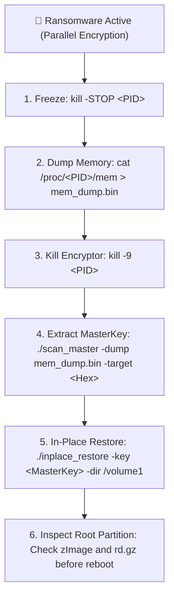

# C3RB3R (.L0CK3D) In-Place Recovery Toolkit & Forensic Case Study

<p align="center">
  <a href="#english">English</a> | <a href="#繁體中文">繁體中文</a>
</p>

<p align="center">
  
  
  
  
  
</p>

---

<a name="english"></a>
## English

An evidence-based, high-performance forensic toolkit and incident recovery guide for victims of the **C3RB3R (.L0CK3D) ransomware** on **Synology DSM (x86_64 / Bare-metal or Virtualized ESXi)**.

> 📖 **Full Real-World Case Study**: For the complete, minute-by-minute battle log across 7 storage pools (>70 TB capacity, 3,863 files recovered), see [docs/case_study_timeline.md](docs/case_study_timeline.md).

### Battle-Tested Recovery Metrics

| Metric | Field Value |
| :--- | :--- |
| **Total Files Successfully Decrypted** | **3,863 files** (100% success rate, 0 failed) |
| **Total Data Volume Restored** | **~2.32 TB** (Multi-media, database engines, container configs, OS kernel) |
| **Ransom Notes Cleaned** | **>12,000+** `read-me3.txt` files wiped across all recovery phases |
| **Extra Disk Space Overhead** | **0 Bytes** (100% In-Place Decrypt & Truncate) |
| **Offline Key Retrieval Duration** | **2.8 Seconds** (via Hardware AES-NI Nonce sliding window match) |

### Key Innovations

1. **Zero Extra Disk Space Overhead (In-Place Truncate)**:
   * Existing recovery scripts (`decrypt_copy.py`) create full duplicate copies of target files, requiring **1:1 free disk space**. For multi-terabyte media or full storage pools (>90% capacity), copy decryption fails with `ENOSPC`.
   * `inplace_restore` seamlessly supports all C3RB3R encryption layouts: Full (`0x24`), Head-only (`0x26`), and Interleaved Multi-Segment (`0x25` spanning head, middle, and end chunks of large files). It overwrites only the encrypted segments directly inside the original file and invokes the `ftruncate` system call to strip the 588-byte metadata footer. **Requires 0 bytes of extra disk space**.
2. **Hidden System Folders (`@`) Decryption**:
   * Complete recursion and in-place recovery for Synology internal directories (`@database`, `@eaDir`, `@synoattr`, `@synoquota`, `@appdata`, `@appstore`), ensuring package services and database daemons resume without errors.
3. **3-Second Offline Key Recovery (The Nonce Invariant)**:
   * Even if the malicious encryptor process was already terminated (`kill -9`) or died due to OOM, as long as a process memory dump (`/proc/<pid>/mem` or coredump) was captured, `scan_master` leverages the mathematical Nonce invariant in the footer to brute-force the 48-byte Session Master Key **within 3 seconds** using hardware-accelerated AES-NI.
4. **Zero Dependencies (Standalone Binary)**:
   * Compiled as a single static binary in Go. No need to install Python 3.11, GCC, or compile C extensions on constrained Synology DSM environments.
5. **DSM Root Partition Survival Guide**:
   * Complete procedures to inspect and restore encrypted system kernel files (`zImage`, `rd.gz`, `updater`) on `/dev/md0` to prevent permanent boot loops.

---

### Triage Workflow



#### Step 1: Emergency Freezing & Memory Dump (Crucial)
```bash
# Locate active malware process
ps aux | grep -E "libgld|libgit"

# Immediately FREEZE it (do NOT kill yet!)
kill -STOP <PID>

# Capture volatile process memory (approx. 60MB - 100MB)
cat /proc/<PID>/mem > /root/mem_dump.bin 2>/dev/null || dd if=/proc/<PID>/mem of=/root/mem_dump.bin

# Save executable binary for forensics
cp /proc/<PID>/exe /root/recovered_malware.bin

# Now terminate the frozen process
kill -9 <PID>
```

#### Step 2: Extract the 48-Byte Master Key
```bash
# Obtain the first 48 bytes of the 588-byte footer from ANY .L0CK3D file:
tail -c 588 /path/to/any_file.L0CK3D | head -c 48 | xxd -p -c 48

# Run scan_master to search the 60MB dump (takes ~2 seconds):
./bin/scan_master_linux_amd64 -dump /root/mem_dump.bin -target <48_BYTES_HEX>
```
*Output Example:*
```text
[SUCCESS] Master Key Found at offset 0x21a00!
  Master IV (16 bytes):  50ba37a8b945... [REDACTED]
  Master Key (32 bytes): 935010c1459c... [REDACTED]
  Master Material (48B): 50ba37a8b945... [REDACTED]
```

#### Step 3: In-Place Decrypt Storage Pools
```bash
# Dry run first to verify keys:
./bin/inplace_restore_linux_amd64 --key <48_BYTES_HEX> --dir /volume1/data --dry-run

# Execute full in-place decryption (8 concurrent workers, 0 extra disk overhead):
./bin/inplace_restore_linux_amd64 --key <48_BYTES_HEX> --dir /volume1/data --workers 8
```

#### Step 4: Verify Root Partition (`/dev/md0`) Before Rebooting
See [docs/dsm_root_recovery.md](docs/dsm_root_recovery.md) for step-by-step audit of `zImage` and `rd.gz`.

---

<a name="繁體中文"></a>
## 繁體中文

本專案是一套專為遭遇 **C3RB3R (.L0CK3D) 勒索病毒** 攻擊的 **Synology DSM（x86_64 實體裸機或 ESXi 虛擬化環境）** 設計的實戰取證與原位無損救災工具箱。

> 📖 **完整實戰復盤時間線**：欲檢閱涵蓋 7 個儲存池（>70 TB 規模、3,863 個檔案全數救回）精確到分鐘的實戰復盤記錄，請參見 [docs/case_study_timeline.md](docs/case_study_timeline.md)。

### 實戰救災核心指標

| 統計維度 | 實戰數值 |
| :--- | :--- |
| **成功解密檔案總數** | **3,863 個檔案**（成功率 100%，0 檔案損毀） |
| **成功解密數據量** | **約 2.32 TB**（包含 4K 影音、資料庫、容器配置、DSM 核心開機檔） |
| **全盤清理勒索信** | **逾 12,000+ 份** `read-me3.txt`（包含初期清理） |
| **額外磁碟空間消耗** | **0 位元組**（全原位原地解密覆寫 + `ftruncate` 截斷） |
| **離線金鑰檢索耗時** | **2.8 秒**（基於 Nonce 恆等自校驗 + 硬體 AES-NI 加速） |

### 核心技術突破

1. **0 位元組額外空間原位截斷還原（In-Place Truncate）**：
   * 社群傳統腳本（`decrypt_copy.py`）採用「複製解密」邏輯，需要 **1:1 的剩餘硬碟空間**。在動輒數十 TB 的儲存池中，硬碟佔用往往超過 90%，直接觸發 `ENOSPC` 空間不足而無法執行。
   * 本工具完整支援 C3RB3R 的全量（`0x24`）、頭部（`0x26`）以及針對大檔案的多段間隔切片（`0x25`，頭部、中部、尾部分段覆蓋）所有加密架構。直接在原檔案上精準覆寫受損數據塊，並調用底層系統調用 `ftruncate` 抹除末尾 588 位元組 Footer。**全過程消耗 0 位元組額外磁碟空間**。
2. **深入修復每個儲存池的 `@` 隱藏系統目錄**：
   * 全盤遞歸並原地解密各 Volume 的 `@database`, `@eaDir`, `@synoattr`, `@synoquota`, `@appdata`, `@appstore` 等中繼資料，確保套件與資料庫服務在災後無縫自愈重啟。
3. **進程終止後的「3 秒離線秒級檢索 Master Key」**：
   * 即使受害者在慌亂中早已終止了病毒進程（`kill -9`），只要曾轉儲過該進程的獨立記憶體（`/proc/<pid>/mem` 或 coredump），`scan_master` 即可利用 Footer 的 Nonce 恆等自校驗特徵，在硬體 AES-NI 加速下 **3 秒內 100% 精準命中 48 位元組 Master Key**。
4. **零依賴單一靜態二進位**：
   * 採用 Go 語言原生編譯，無需在群暉受限的終端裡折騰 Python 3.11、pip 或 gcc 編譯環境，上傳賦權即可直接執行。
5. **群暉根目錄引導防崩潰指南**：
   * 完整覆蓋了系統根分區（`/dev/md0`）核心檔案（`zImage`, `rd.gz`, `updater`）的修復檢查，防止重啟後進入 Boot Loop 死循環。

---

### 快速救災流程

#### 第一步：凍結進程與記憶體取證
```bash
# 1. 查找惡意進程 PID
ps aux | grep -E "libgld|libgit"

# 2. 第一時間凍結進程（切勿直接 kill！）
kill -STOP <PID>

# 3. 轉儲該進程的獨立記憶體空間（約 60MB～100MB）
cat /proc/<PID>/mem > /root/mem_dump.bin 2>/dev/null || dd if=/proc/<PID>/mem of=/root/mem_dump.bin

# 4. 保存惡意二進位樣本備查
cp /proc/<PID>/exe /root/recovered_malware.bin

# 5. 轉儲完成後徹底終止進程
kill -9 <PID>
```

#### 第二步：秒級檢索 48 位元組 Master Key
```bash
# 取得任意被加密檔案末尾 588 位元組中的前 48 位元組：
tail -c 588 /path/to/any_file.L0CK3D | head -c 48 | xxd -p -c 48

# 執行秒級檢索器（耗時約 2 秒）：
./bin/scan_master_linux_amd64 -dump /root/mem_dump.bin -target <48_BYTES_HEX>
```

#### 第三步：0 空間原位覆寫解密
```bash
# 先進行 Dry-Run 模擬驗證金鑰：
./bin/inplace_restore_linux_amd64 --key <48_BYTES_HEX> --dir /volume1/data --dry-run

# 正式多線程並行原位還原：
./bin/inplace_restore_linux_amd64 --key <48_BYTES_HEX> --dir /volume1/data --workers 8
```

#### 第四步：重啟前務必檢查 DSM 根分區引導
詳細檢查清單請參見 [docs/dsm_root_recovery.md](docs/dsm_root_recovery.md)。

---

### 深入文件 (Documentation)

* [docs/case_study_timeline.md](docs/case_study_timeline.md)：實戰案例復盤與精確到分鐘的完整時序記錄。
* [docs/technical_architecture.md](docs/technical_architecture.md)：C3RB3R 加密機制、588 位元組 Footer 記憶體佈局與 Nonce 恆等推導。
* [docs/dsm_root_recovery.md](docs/dsm_root_recovery.md)：群暉系統根目錄核心開機檔修復清單。

---

### 👥 Contributors & Pair Programming

* **Incident Commander & System Administrator**: [@penv13](https://github.com/penv13)
* **AI Incident Response & Reverse Engineering Assistant**: **Antigravity (Google DeepMind)**

---

### 致謝 (Acknowledgements)

特別感謝以下開源應急項目與安全研究團隊的前期貢獻：
* [`soimy/c3rb3r-rescue`](https://github.com/soimy/c3rb3r-rescue)
* [`Benjamin-zlt/c3rb3r-baremetal-rescue`](https://github.com/Benjamin-zlt/c3rb3r-baremetal-rescue)
* REA / ASTRA 安全應急響應團隊
* LINUX DO 救災直播社群

---

### 免責聲明 (Disclaimer)

本專案代碼與文檔僅用於安全應急響應、數據恢復與學術研究。操作前請確保已對關鍵進程記憶體與底層分區做好必要保全。作者對任何因不當操作導致的數據遺失概不負責。
